## Evidence: stats panel crushing blow / critical strike / pierce / poison length / curse rows

Branch `fix/stats-damage-rows` @ `5c11f08` against upstream `main` @ `381e0ee`. Verified in the **live PD2 client** (Season 13 CDN mirror; ProjectDiablo.dll sha256 `538a77b7…`, linked Wed May 13 2026), single player, by the bh-harness scenario `S2-stats-damage-rows` (Assassin, level 1, Normal; normal-quality weapons; skills and stats set through the harness agent) and the harness pre-PR pipeline (`pr-check.sh --upstream`, run id `004754-49086`).

| | BH.dll | S2 result |
|---|---|---|
| before | upstream `main` 381e0ee (clang-cl build `8a835f81…`) | **XFAIL**: 17 of 29 checked lines wrong |
| before | shipped PD2 BH.dll `cba04ff9…` | **XFAIL**: the same 17 lines, drawn identically to upstream `main` |
| after | this branch (clang-cl build `07a98140…`) | **XPASS**: 29/29 lines as expected |

The clang-cl builds carry the harness build patch `3c1c872` (clang-cl can't compile upstream's MSVC `__event` code); it is applied to both sides and is not part of the PR.

### What the client's stat list holds

Masteries at level 20 (exploratory session, shipped BH). The client's layer-0 stats (`D2COMMON_GetUnitStat(unit, stat, 0)`, what BH reads) did not change with the weapon. For a Barbarian with Two Hand Mastery and Throwing Mastery that held for a hand axe, large axe, throwing axe, double axe, falchion and unarmed. For an Amazon with Javelin and Spear Mastery it held for javelins, a spear, a short bow and a short sword:

| stat | client | server (layer 0) |
|---|---|---|
| 136 item_crushingblow | 29 | 0 |
| 166 skill_pierce | 41 | 0 |
| 256 item_crit_multiplier | 29 | 0 |

The server keeps these passive stats on the mastery's item-type layer (D2Common `SKILLS_RefreshSkill` in D2MOO: `STATLIST_SetStat(pStatList, nPassiveStat, nValue, nPassiveIType)`), so they only count with a matching weapon. The client copy is unconditional, so BH has to remove them when the weapon does not match. `GetMasteryStat` only did that for pierce, and the pierce call was commented out.

### Expected values (PD2 Skills.txt, level 20)

| mastery | passive stat | calc | value | applies with (passiveitype) |
|---|---|---|---|---|
| Two Hand Mastery (134) | item_crushingblow | dm56, par5 0, par6 35 | 0 + 35·(110·20/26)/100 = **29** | `2han` (two-handed melee) |
| Two Hand Mastery (134) | item_crushingblow_efficiency | min(edln, 25) | min(10+7+8+4, 25) = **25** → 125% | `2han` |
| Throwing Mastery (135) | skill_pierce | edln, ELen 15, 2/1/1 | 15+7·2+8+4 = **41** | `thro` |
| Javelin and Spear Mastery (19) | item_crit_multiplier | edmn, EMin 10, 1/level | 10+19 = **29** → 229% | `spea` |
| Claw and Dagger Mastery (252) | passive_mastery_melee_crit | dm56, par5 0, par6 30 | 30·(110·20/26)/100 = **25** | `asm` (claws, daggers) |

Item types: hand axe `axe`; large axe two-handed; javelin `jave` = `thro` + `spea`; katar `h2h` → `asm`. The scenario computes these values from Skills.txt at run time.

### Lines: before vs after

| case | row | before | after (= expected) |
|---|---|---|---|
| hand axe | Crushing Blow | `29 / 125%` | `0 / 100%` |
| hand axe | Critical Strike | `0 / 75 / 229%` | `0 / 75 / 200%` |
| hand axe | Projectile Pierce | `41` | `0` |
| large axe | Crushing Blow | `29 / 125%` | `29 / 125%` |
| large axe | Critical Strike | `0 / 75 / 229%` | `0 / 75 / 200%` |
| large axe | Projectile Pierce | `41` | `0` |
| javelin | Crushing Blow | `29 / 125%` | `0 / 100%` |
| javelin | Critical Strike | `0 / 75 / 229%` | `0 / 75 / 229%` |
| javelin | Projectile Pierce | `41` | `41` |
| katar, Attack | Crushing Blow | `29 / 125%` | `0 / 100%` |
| katar, Attack | Critical Strike | `0 / 75 / 229%` | `25 / 75 / 200%` |
| katar, Attack | Projectile Pierce | `41` | `0` |
| katar, Tiger Strike | Crushing Blow | `29 / 125%` | `0 / 100%` |
| katar, Tiger Strike | Critical Strike | `0 / 75 / 229%` | `25 / 75 / 200%` |
| katar, Tiger Strike | Projectile Pierce | `41` | `0` |
| unarmed | Crushing Blow | `29 / 125%` | `0 / 100%` |
| unarmed | Critical Strike | `0 / 75 / 229%` | `0 / 75 / 200%` |
| unarmed | Projectile Pierce | `41` | `0` |
| poison length reduction 50% | Poison Resist | `0 / 75  Length: 50%` | `0 / 75  Length: 50%` |
| poison length reduction 100% | Poison Resist | `0 / 75  Length: 0%` | `0 / 75  Length: 25%` |
| curse resistance 90%, reduced curse duration 80% | Curse Resist | `75 / 75 Length: 25%`, `/` orange | `75 / 75 Length: 25%`, `/` white |
| life/mana stolen per hit 7/5 (control) | Life / Mana Leech | `7` / `5` | `7` / `5` |

Poison length: the game applies the difficulty penalty (PD2 DifficultyLevels.txt ResistPenalty 0/-40/-100) to "Poison Length Reduced by", clamps the result to -100..75 and scales the length by (100 - that)%, so it runs from 25% to 200% (D2Game `SUNITDMG_CalculateTotalDamage`, "Plen" row). BH printed `100 - penalty - reduction` without the clamp.

### Screenshots (live PD2 client)

Rows only (2x):

| case | before | after |
|---|---|---|
| hand axe |  | 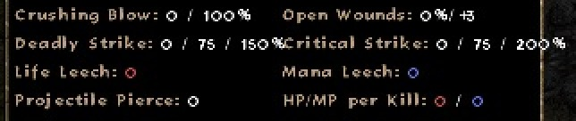 |
| large axe | 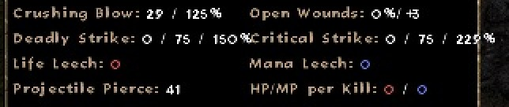 | 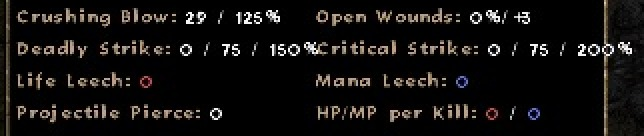 |
| javelin |  | 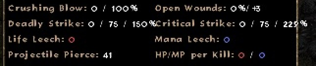 |
| katar, Attack | 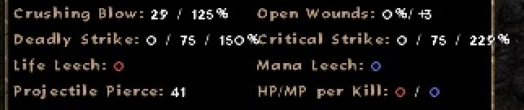 |  |
| katar, Tiger Strike | 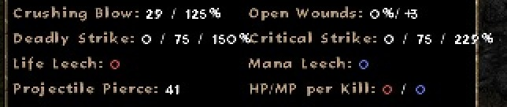 | 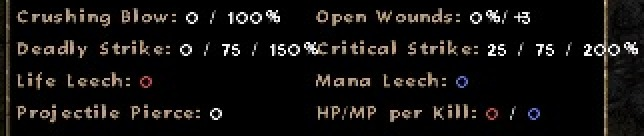 |
| resist rows (poison 100%, curse 90/80) | 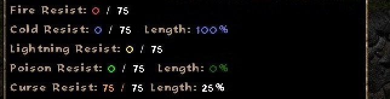 | 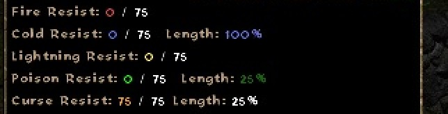 |

Full frames:

| case | before | after |
|---|---|---|
| hand axe | 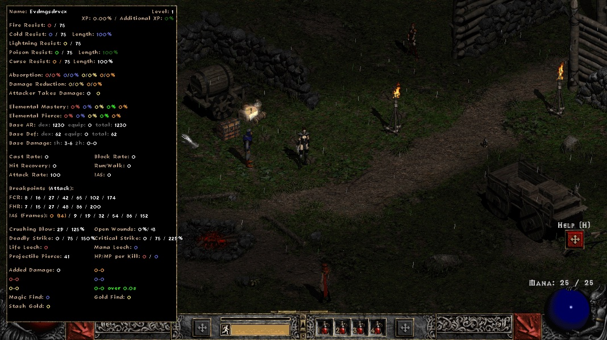 |  |
| large axe | 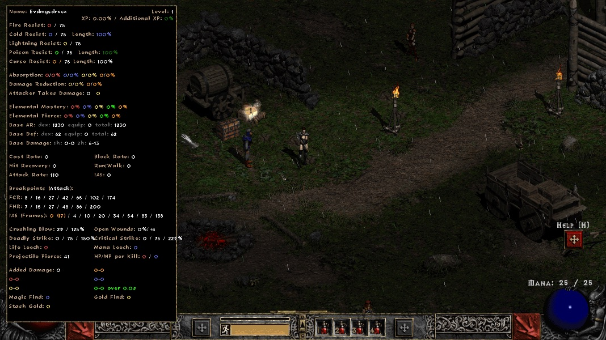 |  |
| javelin | 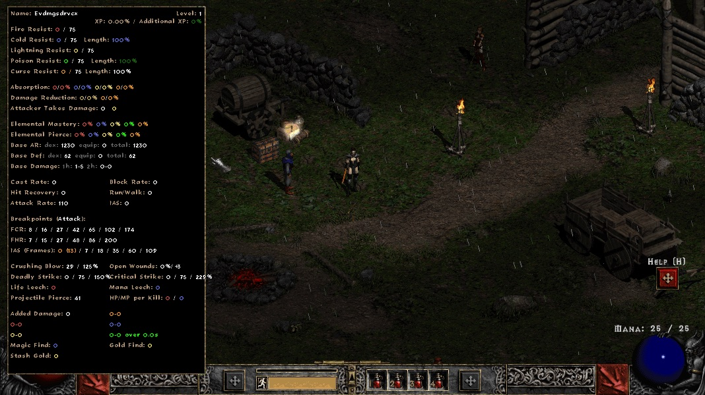 |  |
| katar, Attack | 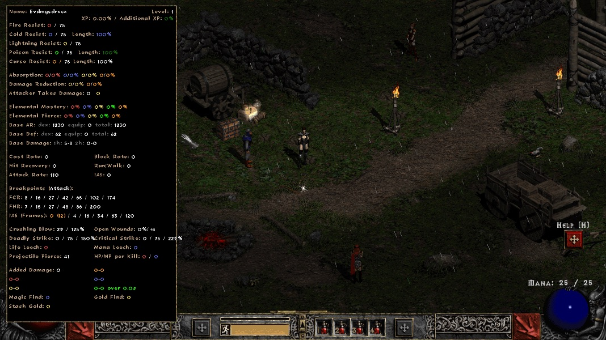 | 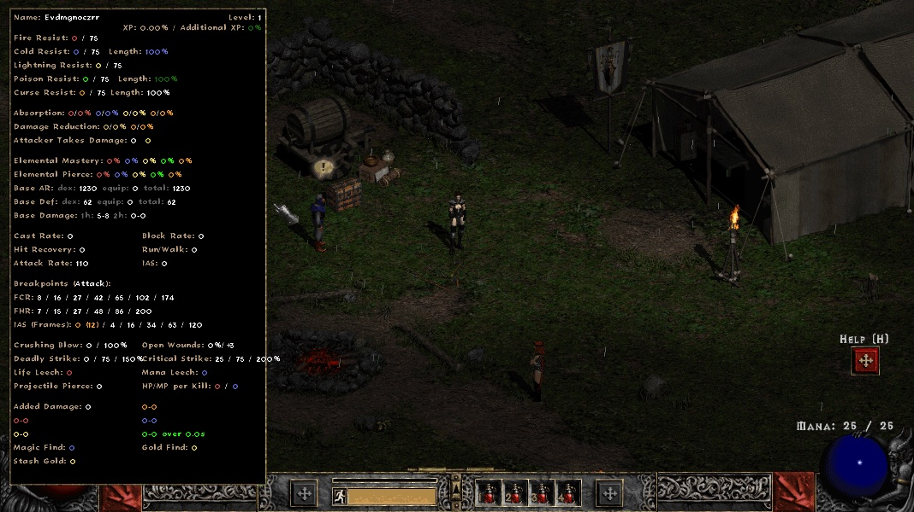 |
| katar, Tiger Strike | 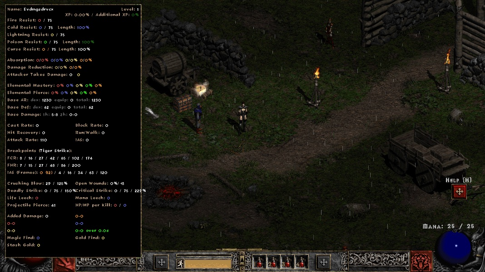 |  |
| resist rows | 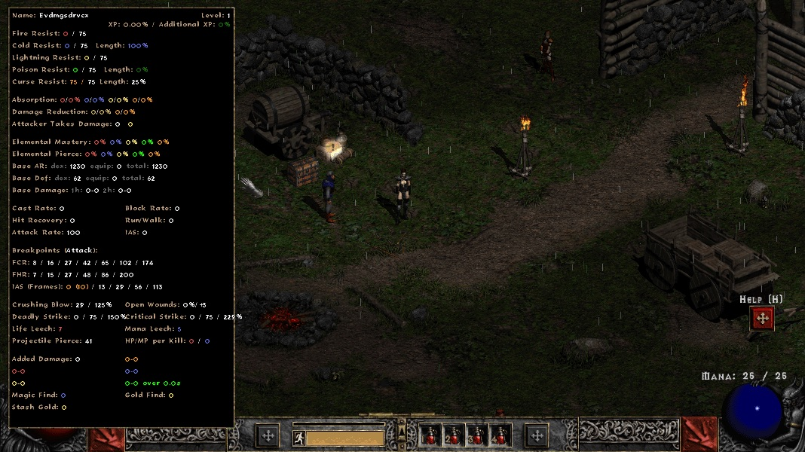 | 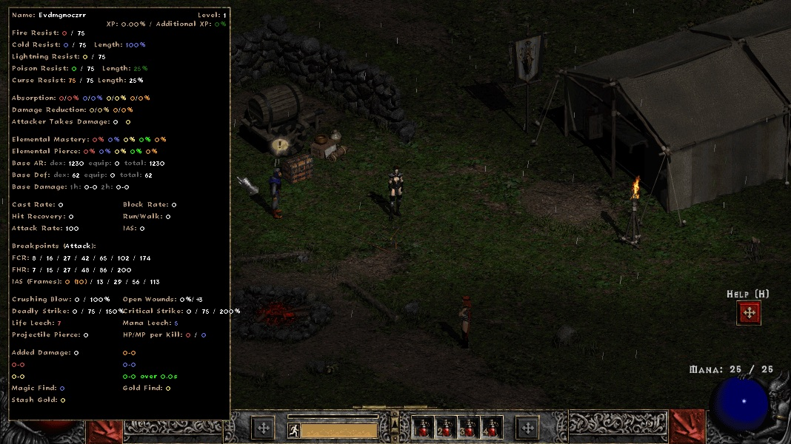 |

### Unit tests (L1, BH's StatsDisplay.cpp compiled natively against a fake engine)

- `BH stats panel: poison length == 100 - clamp(reduction + difficulty penalty, -100, 75)`: 13 cases over Normal/Nightmare/Hell. Upstream `main`: XFAIL (e.g. Normal 100% → 0, Hell 225% → -25, Hell -50% → 250). This branch: passes.
- `BH stats panel: resist rows draw '/ max' in white; curse resist and curse length capped at 75%`: upstream `main`: XFAIL (curse row `/` color 8); this branch: passes.
- Suite: base `61 passed, 12 xfail, 0 failed`; branch `61 passed, 10 xfail, 2 failed`, the 2 being exactly these two tests reporting XPASS. All other tests unchanged.

`GetMasteryStat` (D2Helpers.cpp) is not compiled in the L1 build, and the 1han/2han/asm item matching is the game's, so the mastery rows are checked in game only.

### Runtime validity

- `build/parity.sh` on this branch's clean build (`07a98140…`): **PASS**, live PD2 10/10 and vanilla 10/10 cold launches.
- Other in-game scenarios, base vs branch: H1-H4, A1 PASS on both; F1, S1-claw-ias, S1-dualwield-ias XFAIL on both (other open breakpoint bugs); C1-C4, S3 BLOCKED on both. V2-ground-fx tests an unmerged ground-effects BH branch: base ERROR (game crash in BH.dll+0x12252b, also on retry), branch FAIL at that feature's first assertion. It does not exercise the stats panel.

### Claims checked and not changed

- **Chance to hit / attack rating ignores -% target defense and Conviction.** The panel has no chance-to-hit line. "Base AR" is dex·5 - 35 + class ToHitFactor (CharStats.txt) plus item `tohit` (stat 19); the in-game value for the test Assassin (dex 250, ToHitFactor 15) was `dex: 1230`, which matches. -% target defense (stat 116) and Conviction lower the monster's defense, not the player's attack rating.
- **Curse resist cap 75 / curse length.** Both caps are right. The PD2 wiki (Game Mechanics, "Curse Duration / Resistance") says both stats cap at 75%. In game, 90% / 80% show `75 / 75 Length: 25%` before and after. Only the `/` color was wrong.
- **Leech values / missing cap line.** In game, stats 60/62 = 7/5 show `Life Leech: 7`, `Mana Leech: 5`. PD2 has no leech cap. The wiki lists situational reductions only: difficulty 1/2 and 1/3, ranged and splash 1/2, some skills, monster drain effectiveness. `lifedrain_percentcap` (stat 488, "cannot life steal when above X% life") is on one unique, Nightmare's Feast. Showing it would be a new row, not a fix.
- **Deadly Strike row** (`min(DS, 75 + max DS)` / cap / 150 + multiplier) and the critical strike cap 75 / 200% base match the PD2 wiki "Critical Damage" table. One Hand Mastery and Throwing Mastery crit chance were already counted only with a matching weapon and skill (in game: 29 with a hand axe, 0 with a large axe; Throwing Mastery 29 with Throw).
