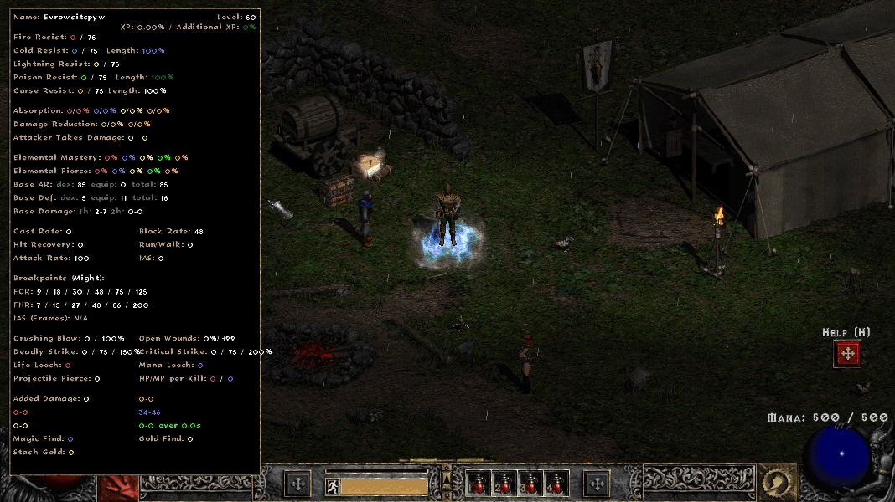
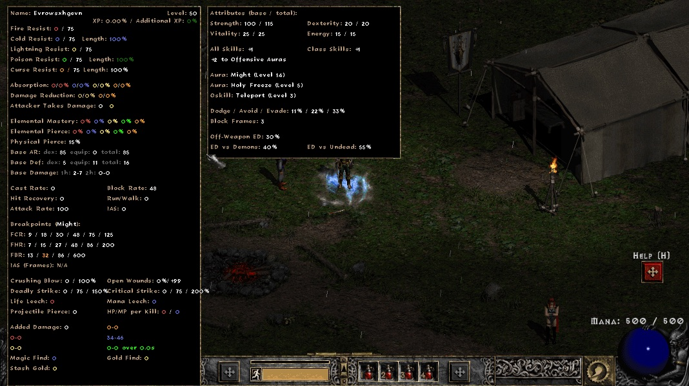
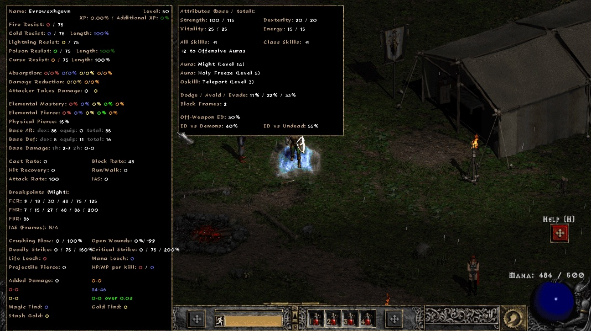
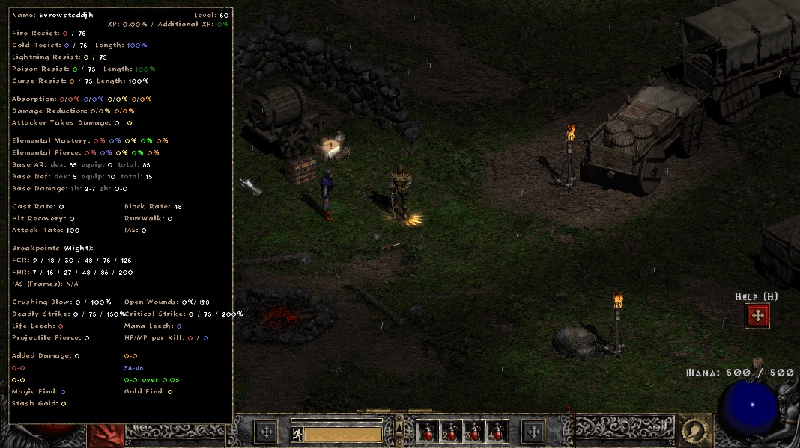

## Evidence: new rows in the advanced stats panel (`feature/stats-panel-rows`)

Branch `feature/stats-panel-rows` @ `3e7bdf6` (base: upstream `main` @ `381e0ee`). The change adds a
Physical Pierce row, an FBR breakpoint line, and a side panel with more player rows to BH's
advanced stats panel (`BH/Drawing/Stats/StatsDisplay.cpp`).

Everything below was checked in the **live PD2 client** (Season 13 CDN mirror, ProjectDiablo.dll
sha256 `538a77b7…`, renderer GDI, 1068x600) by an automated single-player scenario, bh-harness
`evidence/scenarios/S3-stats-panel-rows.sh` (harness commit `b4e2f9f`). The scenario puts known stats
on normal-quality gear and checks that each drawn line matches.

| | BH.dll | S3 result |
|---|---|---|
| before | upstream `main` 381e0ee, clang-cl build `8a835f81…` | **BLOCKED**: no FBR line and no side panel (screenshot taken, then stopped) |
| before (shipped) | shipped PD2 BH.dll `cba04ff9…` | **BLOCKED**: same as above |
| after | this branch, clang-cl build `f59b1334…` | **PASS**: every assertion below |

The clang-cl builds of both sides include the harness build patch `3c1c872` (clang-cl can't compile
upstream's MSVC `__event` model), applied to base and branch alike. `60cd0cf` (DllMain fix) is already
part of 381e0ee (#93), so it was not applied.

### Layout

PD2 runs at 600 px height. The main panel was already 558 px tall at y=10. Adding the FBR line and
the Physical Pierce row brings it to 590 px, which fills the screen. The remaining rows go in a
second box of the same width next to the main panel. It is drawn to the right, or to the left when
`statsOnRight` is set, and only on the player tab (not the merc tab). Clicking either box closes the
panel. Existing rows are unchanged.

### Setup (SP Paladin, level 50)

| source | stats |
|---|---|
| hard points | Str 100 (`sp.stat.set`) |
| cap | +15 Str, +1 all skills (127), +1 Paladin skills (83/3), +2 to tab 1 (188, param 3<<3\|1), item aura Holy Freeze (151/114) lvl 5, oskill Teleport (97/54) +2 |
| gloves | 30% ED (17/18), 40% ED vs demons (121), 55% ED vs undead (122), 15% physical pierce (425), dodge/avoid/evade 11/22/33 (338-340), 48 FBR (102) |
| right hand / left hand | Short Sword (1HS) / Buckler |
| skills | Might (98) base 10, selected on the right button (aura running, state 33). Holy Shield (117) lvl 1, cast for the second half |

Each stat is set on the server item before it is equipped and copied onto the client item
(new `sp.item.spawn "stats"` argument in the harness agent). `sp.inspect` confirms that the client
and server totals match.

### Assertions (after = this branch, `S3-stats-panel-rows` run `2026-10-05T01-06-27-005027-65116-branch`)

| check | expected from | BH draws |
|---|---|---|
| Strength base / total | hard 100, cap +15 | `Strength: 100 / 115` |
| Dexterity / Vitality / Energy | `sp.inspect` base / total | `Dexterity: 20 / 20`, `Vitality: 25 / 25`, `Energy: 15 / 15` |
| all skills / class skills | cap | `All Skills: +1`, `Class Skills: +1` |
| skill tab | cap, tab 1 = CharStats StrSkillTab2 | `+2 to Offensive Auras` |
| own aura | 10 + 1 all + 1 class + 2 Offensive Auras | `Aura: Might (Level 14)` |
| item aura | item_aura level | `Aura: Holy Freeze (Level 5)` |
| oskill | +2 + 1 all skills (class/tab bonuses don't apply) | `Oskill: Teleport (Level 3)` |
| physical pierce | gloves | `Physical Pierce: 15%` |
| dodge / avoid / evade | gloves | `Dodge / Avoid / Evade: 11% / 22% / 33%` |
| off-weapon ED | gloves | `Off-Weapon ED: 30%` |
| ED vs demons / undead | gloves | `ED vs Demons: 40%`, `ED vs Undead: 55%` |
| FBR line, FBR 48 | `bp-expect --kind fbr --class paladin --weapon 1HS --stat 48 --data pd2` | `FBR: 13 / 32 / 86 / 600` (32 highlighted) |
| block frames, FBR 48 | same, `.frames` | `Block Frames: 3` |
| FBR line with Holy Shield | `… --holy-shield` | `FBR: 86` |
| block frames with Holy Shield | same | `Block Frames: 2` |

`bp-expect` is the harness's independent rates oracle (`logic/oracle/rates.cpp`). Its FBR tables
match the PD2 wiki and maxroll FBR tables (L1 test `rates oracle == PD2 wiki FCR/FHR/FBR tables`).

Off-weapon ED: in game, a hand axe with 100% ED leaves the player's `item_maxdamage_percent` (17) at
0 while its damage doubles (player damage 3-6 → 6-12). Gloves with 30% ED raise it to 30. The weapon's
own ED (ItemStatCost op 13) is applied to the weapon, so the player's stat 17 is already the off-weapon
total, and BH prints it unchanged.

### Unit tests (L1, bh-harness `logic/tests/bh_stats_rows.cpp`)

These compile the real `StatsDisplay.cpp` against the harness's fake engine:
- FBR line and Block Frames vs the oracle, for all 7 classes × 10 weapon classes (+ claws), Paladin
  with Holy Shield, and Druid wolf/bear. FBR values 0/15/48/86/200, 180 lines compared. Classes with
  no block animation in AnimData (2H, bows, crossbows) draw `FBR: N/A`.
- Physical pierce, dodge/avoid/evade, off-weapon ED, ED vs demons/undead.
- Attributes base/total, +all/+class skills.
- Item aura and oskill (oskill level includes +skills), plus the "none" row.

`logic/run-tests.sh` on the branch: `61 passed, 12 xfail, 0 failed`. On a checkout without the rows,
the new cases skip (no FBR line).

### pr-check (`./pr-check.sh feature/stats-panel-rows --base 381e0ee --upstream --runtime-patch 3c1c872`, exit 0)

- L0 build ok on both sides. L1: no status changes.
- Parity gate on the clean branch build: **PASS**, pd2 10/10 and vanilla 10/10 cold launches.
- L3, live PD2: S3-stats-panel-rows BLOCKED → **PASS**. All other scenarios had the same result on both
  sides. V1-ground-labels (MISSING) and V2-ground-fx (ERROR) failed on base and branch alike.

### Not included

- **Auras from other units** (party Paladin, merc): the client has the aura's state, but BH has no
  client-side value for the level of an aura cast by another unit, so these are not listed. The side
  panel lists the player's own running aura (right-button aura skill with its state set, total
  level) and item auras (`item_aura`).
- **Single-skill bonuses** (`item_singleskill` 107, e.g. "+3 to Fire Ball") are not part of the +skills
  summary (scope: all / class / tab).
- **Not tested in game:** jewels socketed into armor or weapons, dual wield, and the `statsOnRight`
  placement of the side panel.

### Screenshots (live PD2 client)

| before (upstream main build) | after (this branch) |
|---|---|
|  |  |

After casting Holy Shield (FBR line `86`, block frames 2):

Shipped PD2 BH.dll, same setup:

