## Evidence: skill attack rate in dual-wield IAS breakpoints (Double Swing, Dragon Tail with two claws)

BH's advanced stats panel computes the `IAS (Frames):` line for the right skill. When both hands hold a weapon, `GetIASBreakpointString`'s dual-wield block (PD2's faster-weapon rule) recomputes the attack rate from `STAT_ATTACKRATE` alone and drops the skill's own modifier that the single-weapon paths add (`nAttackRateBonus`: Double Swing +50 = Skills.txt Param5, Dragon Tail -20 = Param4). Double Swing requires two weapons, so its line always showed Frenzy's breakpoints; Dragon Tail with two claws ignored its -20 penalty.

Verified in the **live PD2 client** (Season 13 CDN mirror) by automated single-player scenarios (bh-harness `evidence/scenarios/S1-claw-ias.sh`, `S1-dualwield-ias.sh`). Each asserts BH's drawn line against the harness oracle (`logic/build/ias-expect`, the exact line BH should draw).

Oracle: Dragon Tail = the kick animation (AIKK, 13 frames @256) at TAS-20; Double Swing/Frenzy = player sequence 11 (17 frames @256) with the -30 sequence penalty, Double Swing +50. Cross-checked against the PD2 wiki Breakpoints page: Dragon Tail row 14/15 cells exact (the wiki lists TAS 0 for 16 frames, the animation reaches 16 at -3), and Double Swing / Frenzy whole sequence = wiki hit 1 + hit 2 - 1 at every TAS from -20 to 200.

| scenario | side | BH.dll | outcome |
|---|---|---|---|
| S1-claw-ias | before | shipped PD2 BH.dll `cba04ff9e6f94494` | **XFAIL** (2026-10-05T01-01-50) |
| S1-claw-ias | after | this branch + clang-cl build patch (`4f3d0f9e4f`) `2aca02c7f903a112` | **XPASS** (2026-10-05T01-02-25) |
| S1-dualwield-ias | before | shipped PD2 BH.dll `cba04ff9e6f94494` | **XFAIL** (2026-10-05T01-02-53) |
| S1-dualwield-ias | after | this branch + clang-cl build patch (`4f3d0f9e4f`) `2aca02c7f903a112` | **XPASS** (2026-10-05T01-03-25) |

### S1-dualwield-ias: BH before, BH after, oracle

Normal-quality weapons, no IAS mods on them; 'IAS' is item IAS (stat 93); `(n)` marks the current frame count.

| case | before | after | oracle |
|---|---|---|---|
| Double Swing, two Hand Axes (WSM 0), IAS 0 | `0 (24) / 3 / 6 / 9 / 14 / 19 / 24 / 32 / 40 / 54 / 70 / 92 / 125 / 180 / 292 / 638` ✗ | `0 (14) / 3 / 13 / 27 / 50 / 89` | `0 (14) / 3 / 13 / 27 / 50 / 89` |
| Double Swing, two Hand Axes (WSM 0), IAS 30 | `0 / 3 / 6 / 9 / 14 / 19 / 24 (18) / 32 / 40 / 54 / 70 / 92 / 125 / 180 / 292 / 638` ✗ | `0 / 3 / 13 / 27 (11) / 50 / 89` | `0 / 3 / 13 / 27 (11) / 50 / 89` |
| Frenzy, two Hand Axes (WSM 0), IAS 0 | `0 (24) / 3 / 6 / 9 / 14 / 19 / 24 / 32 / 40 / 54 / 70 / 92 / 125 / 180 / 292 / 638` | `0 (24) / 3 / 6 / 9 / 14 / 19 / 24 / 32 / 40 / 54 / 70 / 92 / 125 / 180 / 292 / 638` | `0 (24) / 3 / 6 / 9 / 14 / 19 / 24 / 32 / 40 / 54 / 70 / 92 / 125 / 180 / 292 / 638` |
| Frenzy, two Hand Axes (WSM 0), IAS 30 | `0 / 3 / 6 / 9 / 14 / 19 / 24 (18) / 32 / 40 / 54 / 70 / 92 / 125 / 180 / 292 / 638` | `0 / 3 / 6 / 9 / 14 / 19 / 24 (18) / 32 / 40 / 54 / 70 / 92 / 125 / 180 / 292 / 638` | `0 / 3 / 6 / 9 / 14 / 19 / 24 (18) / 32 / 40 / 54 / 70 / 92 / 125 / 180 / 292 / 638` |
| Fanaticism on the right skill: BH times the right skill, an aura -> N/A | `N/A` | `N/A` | `N/A` |
| the panel's Attack Rate line shows the aura's attack rate | `Attack Rate: 135` | `Attack Rate: 135` | `Attack Rate: 135` |

- Fanaticism lvl 20: attack rate client 100 -> 135, server 100 -> 135

### S1-claw-ias: BH before, BH after, oracle

Normal-quality weapons, no IAS mods on them; 'IAS' is item IAS (stat 93); `(n)` marks the current frame count.

| case | before | after | oracle |
|---|---|---|---|
| Dragon Tail, one Katar (HT1 WSM -10), IAS 0 | `0 (14) / 4 / 11 / 23 / 39 / 63 / 102 / 187` | `0 (14) / 4 / 11 / 23 / 39 / 63 / 102 / 187` | `0 (14) / 4 / 11 / 23 / 39 / 63 / 102 / 187` |
| Dragon Tail, one Katar (HT1 WSM -10), IAS 30 | `0 / 4 / 11 / 23 (11) / 39 / 63 / 102 / 187` | `0 / 4 / 11 / 23 (11) / 39 / 63 / 102 / 187` | `0 / 4 / 11 / 23 (11) / 39 / 63 / 102 / 187` |
| Dragon Tail, two Katars (HT2 WSM -10), IAS 0 | `0 (11) / 10 / 26 / 50 / 95` ✗ | `0 (14) / 4 / 11 / 23 / 39 / 63 / 102 / 187` | `0 (14) / 4 / 11 / 23 / 39 / 63 / 102 / 187` |
| Dragon Tail, two Katars (HT2 WSM -10), IAS 30 | `0 / 10 / 26 (9) / 50 / 95` ✗ | `0 / 4 / 11 / 23 (11) / 39 / 63 / 102 / 187` | `0 / 4 / 11 / 23 (11) / 39 / 63 / 102 / 187` |
| Attack, two Katars (A1 HT2 WSM -10), IAS 0 | `0 (12) / 4 / 16 / 34 / 63 / 120` | `0 (12) / 4 / 16 / 34 / 63 / 120` | `0 (12) / 4 / 16 / 34 / 63 / 120` |
| Attack, two Katars (A1 HT2 WSM -10), IAS 30 | `0 / 4 / 16 (10) / 34 / 63 / 120` | `0 / 4 / 16 (10) / 34 / 63 / 120` | `0 / 4 / 16 (10) / 34 / 63 / 120` |
| Attack, two Katars, Burst of Speed (Skill IAS 45), IAS 0 | `0 (8) / 18` | `0 (8) / 18` | `0 (8) / 18` |
| Attack, two Katars, Burst of Speed (Skill IAS 45), IAS 30 | `0 / 18 (7)` | `0 / 18 (7)` | `0 / 18 (7)` |

- Burst of Speed lvl 10: attack rate client 110 -> 155, server 110 -> 155 (Skill IAS 45)

### Screenshots (live PD2 client)

| | before (shipped BH) | after (this branch) |
|---|---|---|
| double-swing-two-axes-ias30 | 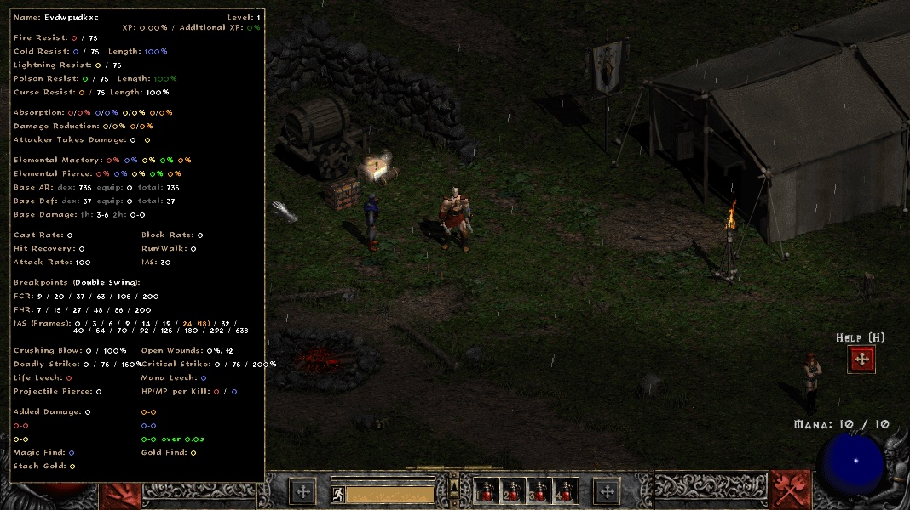 | 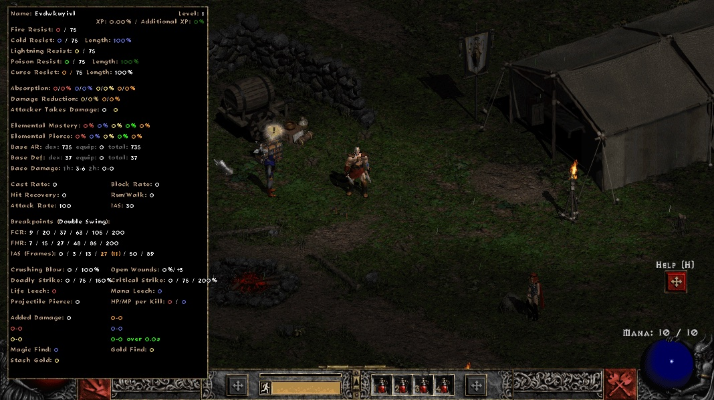 |
| frenzy-two-axes-ias30 |  | 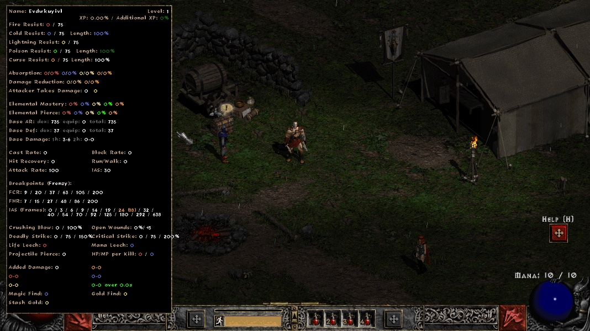 |
| fanaticism-right-skill | 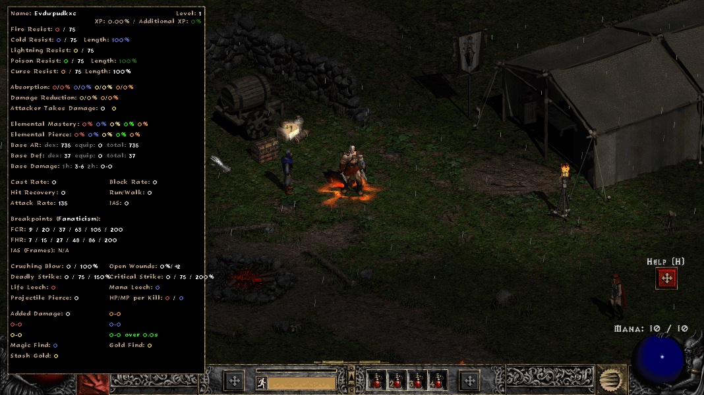 | 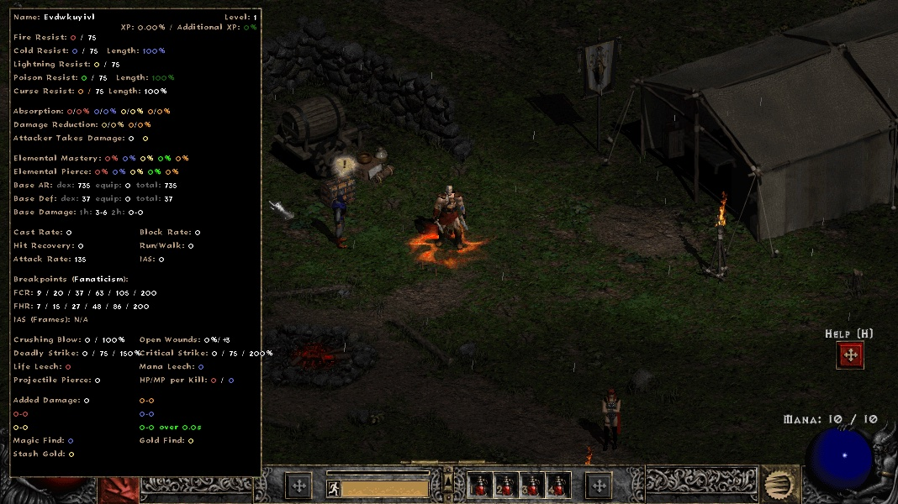 |
| dragon-tail-one-claw-ias30 | 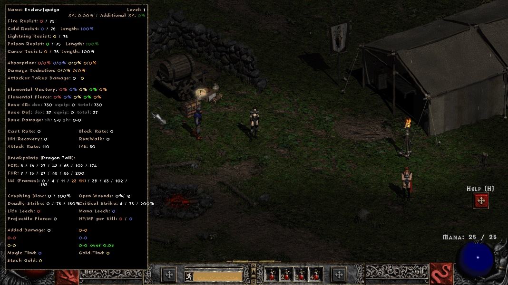 | 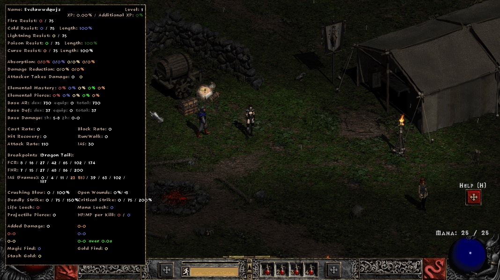 |
| dragon-tail-two-claws-ias30 | 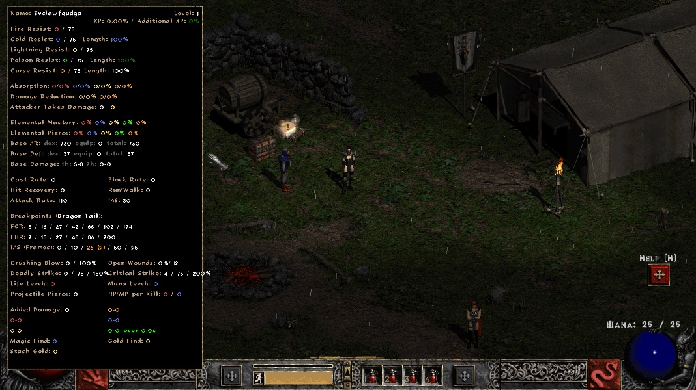 |  |
| attack-two-claws-ias30 | 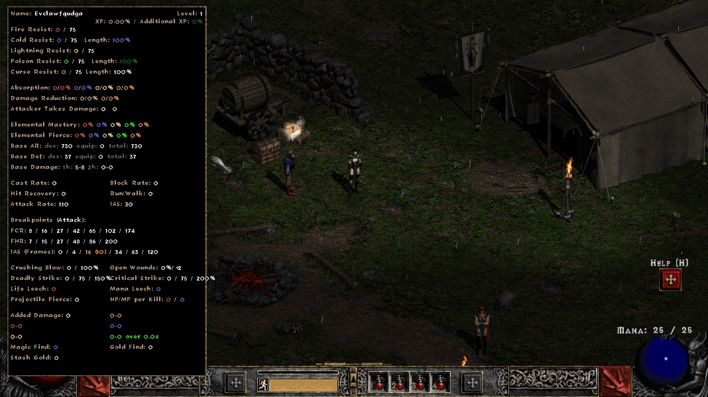 |  |
| attack-two-claws-burst-of-speed-ias30 | 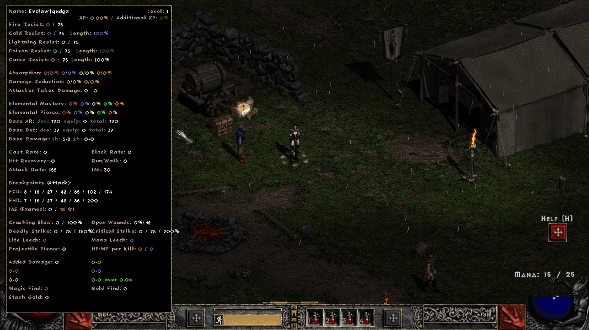 | 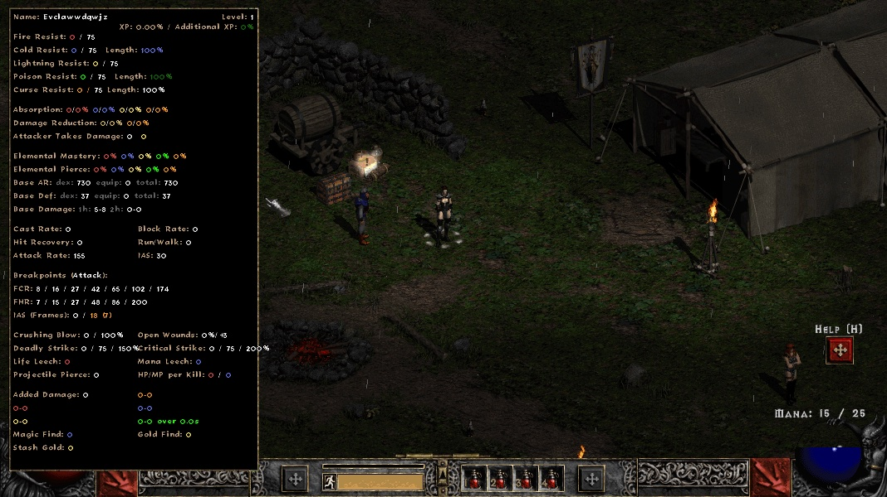 |

Runs: bh-harness `b4e2f9f` (contains the S1 scenarios/oracle commit `40c7dcd`); after-side DLL = branch `b7e957f` + the harness clang-cl build patch `3c1c872` (build only; the PR does not contain it), sha256 `2aca02c7f903a112`.

### Unit tests (L1, BH's real `StatsDisplay.cpp` compiled natively against a fake engine and the oracle)

| test | upstream `381e0ee` | this branch |
|---|---|---|
| BH IAS breakpoints == oracle: Assassin Dragon Tail with two claws (3 weapon pairs × SIAS 0/30 × IAS 0/40) | XFAIL | **PASS** |
| BH IAS breakpoints == oracle: Barbarian Double Swing (two weapons) | XFAIL | **PASS** |
| BH IAS breakpoints == oracle: Assassin Dragon Tail with one claw (control) | PASS | PASS |
| BH IAS breakpoints == oracle: dual wield without a skill modifier (Barbarian Frenzy, Assassin two-claw attack) (control) | PASS | PASS |
| oracle == PD2 wiki: Assassin Dragon Tail kick / Barbarian Double Swing and Frenzy sequences | PASS | PASS |

Every other test has the same status on both trees (`logic: 61 passed, 12 xfail` on upstream; on the branch the two pins above report XPASS).

### Pre-PR pipeline (bh-harness `pr-check.sh --upstream`, base `381e0ee`, runtime patch `3c1c872` on both sides)

- Parity gate on a clean build of the branch: **PASS**, live PD2 10/10 and vanilla 10/10 cold launches.
- L3 in the live PD2 client: S1-claw-ias and S1-dualwield-ias XFAIL → XPASS; H1-H4, A1, F1, S2 unchanged; C1-C4/S3 BLOCKED and V1/V2 MISSING/ERROR on both sides (pre-existing, unrelated scenarios).

### Reported issues that are not BH bugs (checked, no change)

- **Single-claw IAS**: equal to the oracle for every weapon class incl. claws (L1, all WSM/SIAS/IAS combinations) and in game (Dragon Tail with one Katar above). The two-claw normal attack line is BH's A1 timing, the PD2 wiki's dual-wield "Hit 1" row; BH does not show the slower A2 "Hit 2" row (a missing second line, not a wrong number).
- **Speed buffs**: Burst of Speed, Fanaticism, Frenzy and Werewolf give the `attackrate` stat (PD2 Skills.txt). The client unit carries it (in game: Burst of Speed lvl 10 +45, Fanaticism lvl 20 +35, client delta = server delta) and BH's line includes it. With Fanaticism selected on the right the line is `N/A`: BH times the right skill, an aura (header "Breakpoints (Fanaticism):").
- **Cloak of Shadows**: no attack-speed stat in PD2 Skills.txt (`skill_armor_percent`, `item_armor_percent` only).
- **Charge**: no published PD2 table and PD2 uses its own skill function (srvdofunc 180); not verifiable here, not changed.
- **`StatsDisplay.cpp:1452` TODO** (`nCurrentFrames` equals `nMinFrames` after the loop): the loop already runs up to `nMaxAnimAcceleration` inclusive, so after it `nPreviousFrameBP` always equals that value and the block only strips the trailing ` / `. Dead code; the drawn line (values and highlighted entry) equals the oracle in every L1 case.
- **Right-click skill only**: the panel names the skill it uses ("Breakpoints (<right skill>):"); non-attack right skills show `N/A`. Not a wrong number.
