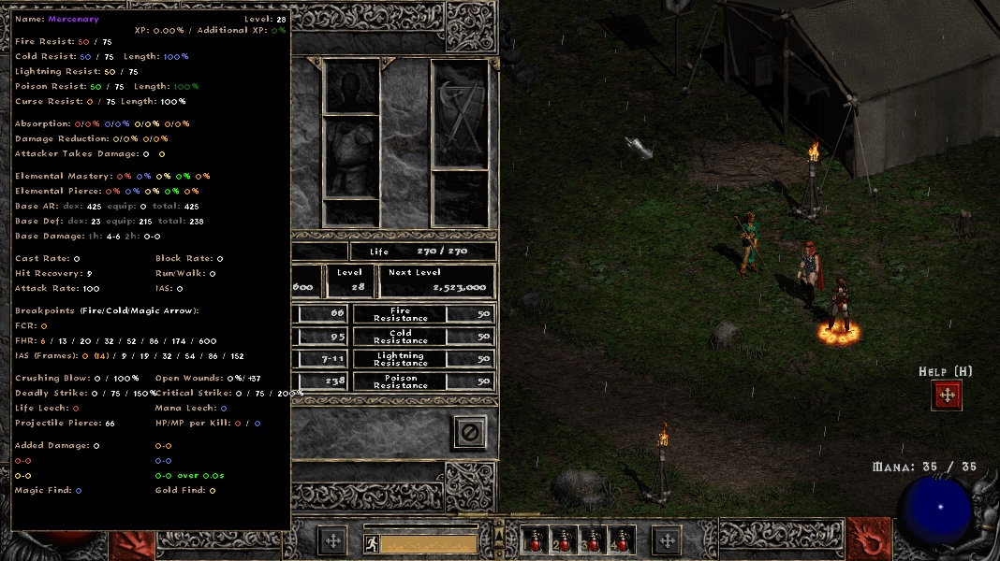
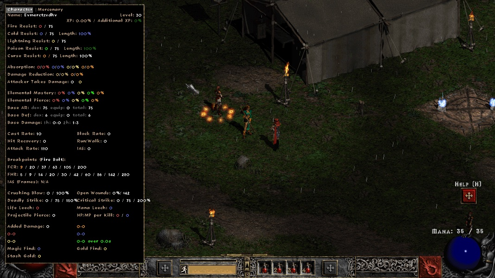
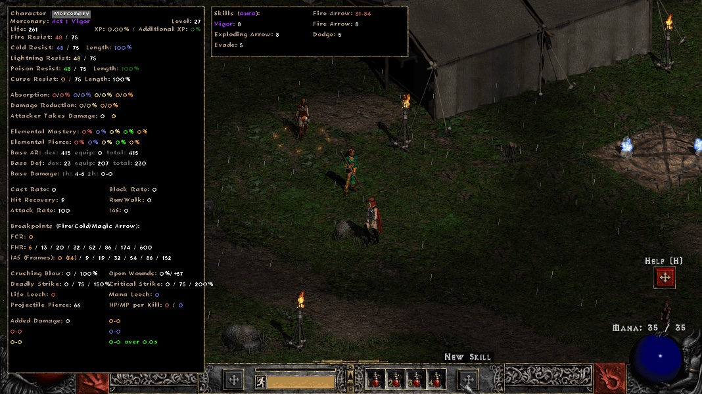
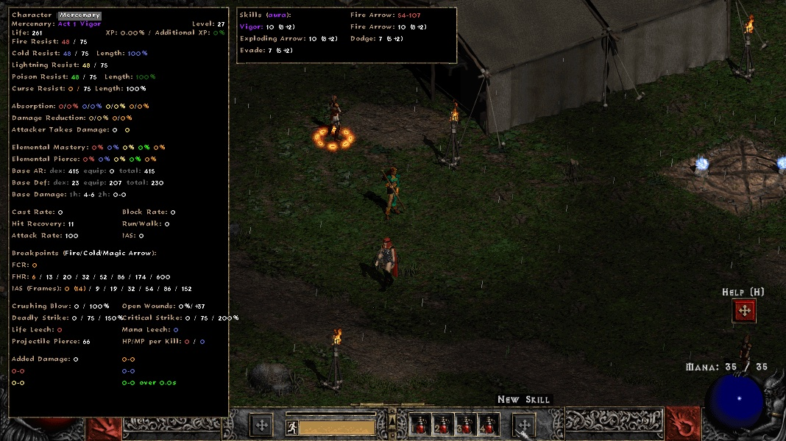
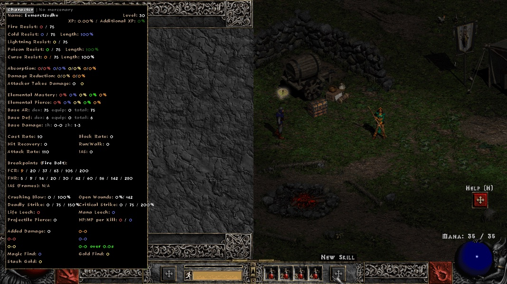
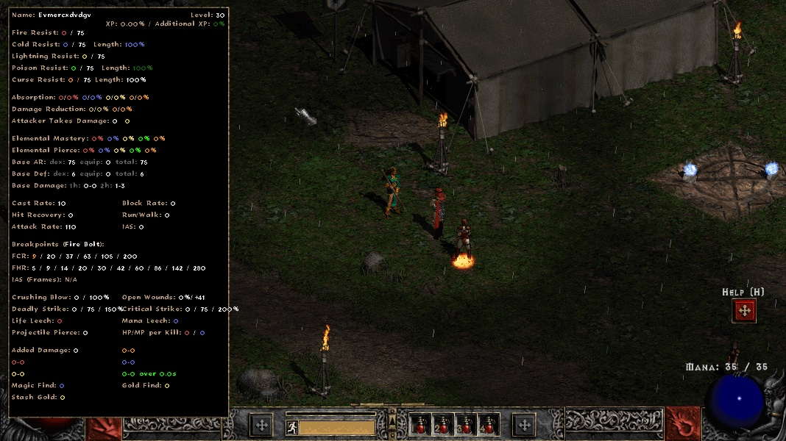

## Evidence: Character | Mercenary tabs in the advanced stats panel (`feature/merc-stats-tab`)

Branch `feature/merc-stats-tab` @ `2b20897` (base: upstream `main` @ `381e0ee`). The change adds a
`Character | Mercenary` tab strip to BH's advanced stats panel (`BH/Drawing/Stats/StatsDisplay.cpp`),
so the merc's stats can be read without opening the merc inventory, plus a side Skills box listing
every merc skill with its level as `total (base+bonus)` and the merc's attack skill damage.

Everything below was checked in the **live PD2 client** (Season 13 CDN mirror, renderer GDI,
1068x600) by an automated single-player scenario, bh-harness `evidence/scenarios/S4-merc-stats-tab.sh`
(harness commit `64c6a69`). The scenario hires an Act 1 Fire Arrow rogue from Kashya and compares
each drawn line with the server-side merc (`merc.inspect`).

| | BH.dll | S4 result |
|---|---|---|
| before (shipped) | shipped PD2 BH.dll `cba04ff9…` | **XFAIL**: no tabs; merc stats only while the merc inventory (O) is open |
| before | upstream `main` 381e0ee, clang-cl build `8a835f81…` | **XFAIL** (pr-check) |
| after | this branch, clang-cl build `ba6cfe4b…` | **PASS**: every assertion below |

The clang-cl builds include the harness build patch `3c1c872` (clang-cl can't compile upstream's
MSVC `__event` model), applied to base and branch alike.

### Assertions (after)

| check | expected from | BH draws |
|---|---|---|
| no merc | — | tab strip `Character \| No mercenary`, greyed, click does nothing |
| Character tab | player | `Name: <char>`, no merc lines |
| Mercenary tab header | Hireling.txt act + aura | `Mercenary: Act 1 Vigor` |
| life / level | server merc | `Life: 243`, `Level: 25` |
| skills box | server merc skill levels | `Vigor: 7`, `Fire Arrow: 7`, `Exploding Arrow: 7`, `Dodge: 5`, `Evade: 5` |
| attack damage | server #10567/#10297, #10121/#11091 at total level | `Fire Arrow: 25-69` |
| +2 all skills (stat 127 = 2) | server total (base+bonus) | `Vigor: 9 (7+2)`, `Fire Arrow: 9 (7+2)`, `Dodge: 7 (5+2)`, … ; `Fire Arrow: 40-90` |
| every row on screen | 600 px height | all within the screen |
| opening merc inventory | — | selects the Mercenary tab |

(Exact numbers vary with merc level per run; each run asserts against its own server values.)

### Screenshots

| before (shipped BH): merc stats need the merc inventory | after: Character tab |
|---|---|
|  |  |

| after: Mercenary tab (rogue) + Skills box | after: +2 all skills `(base+bonus)` |
|---|---|
|  |  |

| after: no mercenary (greyed tab) | before (shipped BH): character page |
|---|---|
|  |  |

### Regression check (bh-harness `pr-check.sh --upstream`)

- L1 unit tests: base and branch `66 passed, 12 xfail, 0 failed`.
- Parity gate (clean build): **PASS**, pd2 10/10, vanilla 10/10 cold launches.
- L3: S4-merc-stats-tab XFAIL → PASS; every other scenario unchanged from base.

### Not covered

- Other acts' mercs were only checked by hand (Act 4 Ascendant, 6 skills: all rows fit). The
  scenario covers the Act 1 rogue only.
